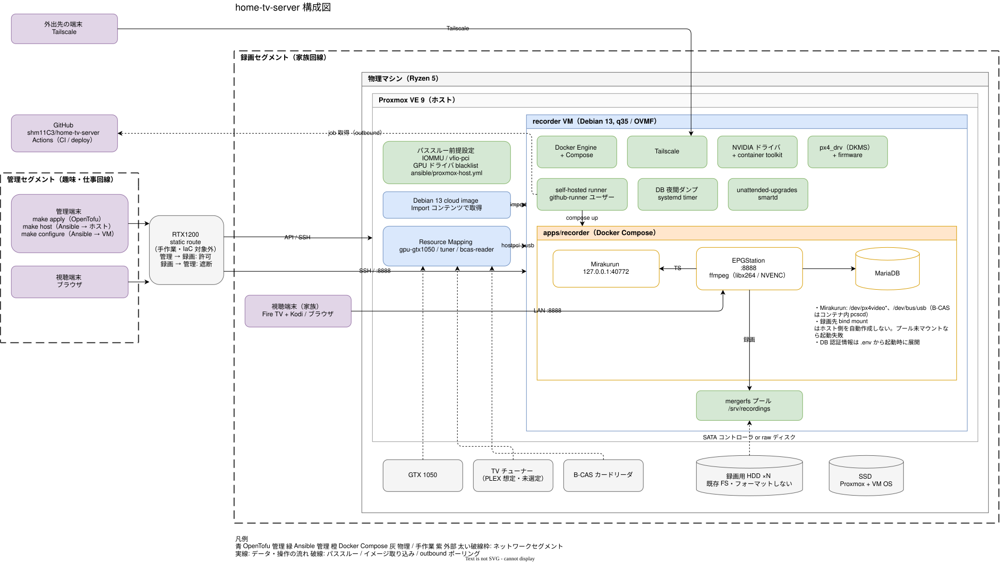

# home-tv-server

Proxmox VE 上に自宅用テレビ録画サーバを構築するためのリポジトリ

public repo ですが、第三者からのPRは受け付けていません

## ゴール

- 4 番組以上の同時録画。公開ポートフォワーディングは行わない
- Tailscale 経由でのリモート予約・再生（Web UI、Fire TV 上の Kodi）
- NVENC（GTX 1050）によるハードウェアトランスコード
- CM 自動検出（後続フェーズ）
- 録画ファイルと EPG データベース以外は Git から再構築できること

## 目標アーキテクチャ



```text
物理マシン (Ryzen 5, GTX 1050, TV チューナー, SSD + 録画用 HDD)
└─ Proxmox VE 9
   ├─ ホスト側: IOMMU / vfio                (ansible/proxmox-host.yml)
   ├─ ハードウェア Resource Mapping          (OpenTofu)
   └─ recorder VM (Debian 13, OpenTofu)
      ├─ Docker Engine + Compose             (ansible/roles/docker)
      ├─ Tailscale                           (ansible/roles/tailscale)
      ├─ NVIDIA ドライバ + container toolkit (ansible/roles/nvidia,  トグル)
      ├─ チューナードライバ px4_drv           (ansible/roles/tuner,   トグル)
      ├─ 録画用 HDD -> mergerfs プール        (ansible/roles/storage)
      └─ apps/recorder (Compose)             (ansible/roles/apps,    トグル)
         ├─ Mirakurun
         ├─ EPGStation + MariaDB
         ├─ 夜間 DB ダンプ                    (ansible/roles/backup)
         └─ self-hosted runner（deploy 用）   (ansible/roles/github_runner, トグル)
```

## ディレクトリ構成

```text
infra/proxmox/       OpenTofu: recorder VM、ハードウェアマッピング、イメージ取り込み
ansible/
  proxmox-host.yml   Proxmox ホスト側の passthrough 前提設定
  site.yml           recorder VM の構成
  roles/             base, docker, storage, tailscale, nvidia, tuner, apps, backup, github_runner, proxmox_host
  group_vars/        公開しても問題ない既定値
  host_vars/*.example  ホスト固有の実値テンプレート（実ファイルは gitignore）
apps/recorder/       Docker Compose スタックと Mirakurun / EPGStation 設定
docs/                bootstrap 手順とアーキテクチャメモ
.github/workflows/   ci（lint / validate / actionlint）と deploy（self-hosted runner、opt-in）
.github/dependabot.yml  SHA pin した action の更新
```

## 前提

- 物理ホストに Proxmox VE 9.x。イメージ用データストアで `Import` コンテンツタイプを有効化していること
- OpenTofu >= 1.8、Ansible、`ansible-lint`、`yamllint`、`actionlint`
- recorder VM 用の SSH 鍵ペア
- Proxmox API トークンを環境変数 `PROXMOX_VE_API_TOKEN` で渡すこと
  （必要な権限は docs/bootstrap.md 手順 6。`recording_disk_passthrough` だけは `root@pam` のパスワード認証が必要）

## プロビジョニング手順

```bash
cp infra/proxmox/terraform.tfvars.example infra/proxmox/terraform.tfvars
cp ansible/inventory/hosts.example.yml    ansible/inventory/hosts.yml
cp ansible/host_vars/recorder.yml.example ansible/host_vars/recorder.yml
export PROXMOX_VE_API_TOKEN='terraform@pve!provider=...'

make host        # Proxmox ホスト: IOMMU / vfio 設定。実行後にホストを一度再起動
make init plan apply
make configure   # recorder VM: base, docker, storage, tailscale（トグル有効時は nvidia / tuner / apps も）
```

`make configure` で `qemu-guest-agent` が入ったあと、`terraform.tfvars` の
`guest_agent_enabled = true` にして再度 `make apply` する。

以下はコミットしない: `terraform.tfvars`、`ansible/inventory/hosts.yml`、
`ansible/host_vars/*.yml`、各 `.env`、state ファイル、鍵、トークン。

## 設計方針

- Proxmox は差し替え可能なハイパーバイザ層として扱う。チューナー・GPU・ディスクをまとめて持たせるため録画機能は 1 VM に集約する
- ハードウェアは Proxmox の Resource Mapping 経由で参照し、VM 定義に生の PCI アドレスを書かない
- 録画用 HDD は個別にマウントして mergerfs で束ねる。このリポジトリはディスクをフォーマットしない
- 機能ロール（`nvidia`、`tuner`、`apps`、`github_runner`）は既定で無効。ハードウェアを確認したホストだけで有効化する。
- アプリのデプロイは recorder VM 上の self-hosted runner が行う。外からの SSH 経路は作らず、runner が GitHub へ取りに行くだけ。公開リポジトリのため Pull Request 作成は Collaborators only に制限し、fork からの workflow 実行は承認必須にする
- Mirakurun と EPGStation は LAN と tailnet からのみ到達可能にする。管理端末は別セグメントにあり、ルーターの static route 経由で Proxmox と VM を操作する。
- 秘密情報は環境変数（`PROXMOX_VE_API_TOKEN`、`TAILSCALE_AUTH_KEY`）か GitHub Secrets で渡し、Git には置かない

物理ホストの引き渡しチェックリストは [docs/bootstrap.md](docs/bootstrap.md)、
責務境界は [docs/architecture.md](docs/architecture.md)、残タスクは [docs/todo.md](docs/todo.md) を参照。

## ライセンス

[MIT](LICENSE)
