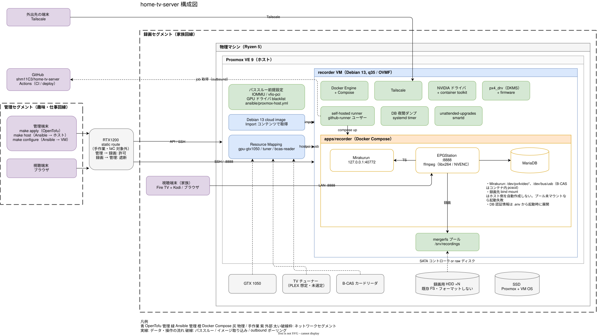

# アーキテクチャ

[architecture.drawio.svg](architecture.drawio.svg) は図データを埋め込んだ SVG で、これが原本。draw.io（デスクトップ版、VS Code 拡張、app.diagrams.net）でそのまま開いて編集できる。保存するとテーマや埋め込み画像が draw.io の既定値に戻るので、保存後に `make diagram` を実行してからコミットする。

## 責務境界

| レイヤー                    | ツール          | Git 管理 | 備考                                                    |
| --------------------------- | --------------- | -------: | ------------------------------------------------------- |
| 物理組み立て / BIOS         | 手作業          | docs のみ | SVM / IOMMU、ディスク、GPU、チューナー                  |
| セグメント間ルーティング    | 手作業          | docs のみ | ルーターの static route とフィルタ。実値は Git に置かない |
| Proxmox インストール        | 手作業          | docs のみ | bootstrap                                               |
| Proxmox ホスト passthrough  | Ansible         |     あり | カーネル引数、vfio、ドライバ blacklist                  |
| ハードウェアマッピング      | OpenTofu        |     あり | Datacenter > Resource Mappings（PCI / USB）             |
| VM ライフサイクル           | OpenTofu        |     あり | CPU、RAM、ネットワーク、OS ディスク、passthrough、raw HDD |
| ゲスト構成                  | Ansible         |     あり | パッケージ、Docker、Tailscale、ストレージ、NVIDIA、チューナー |
| 録画アプリケーション        | Docker Compose  |     あり | Mirakurun、EPGStation、MariaDB（`apps/recorder`）       |
| アプリケーションのデプロイ  | GitHub Actions  |     あり | recorder VM 上の self-hosted runner（opt-in）           |
| 録画ファイル / DB           | ランタイム状態  |     なし | DB は `roles/backup` が夜間ダンプ。録画ファイルはバックアップしない |

## VM の境界

ハードウェアに触る要素はすべて 1 つの recorder VM に閉じ込める。チューナー・GPU・デバイスアクセスを複数コンテナに分散させないことで復旧を単純にする。

## ストレージ

OS ディスクは Debian cloud image から取り込んだ仮想ディスク。録画用 HDD は別枝でモデル化し、次のいずれかで VM に見せる。

1. SATA コントローラが独立した IOMMU グループにある場合は、Resource Mapping 経由で PCI passthrough する（推奨）。制限付き API トークンのまま運用できる。
2. それができない場合は OpenTofu の `recording_disk_passthrough` でブロックデバイスを丸ごと渡す。provider 上 experimental で、apply には `root@pam` のパスワード認証が必要になる。

VM 内では既存ファイルシステムを `nofail` 付きで個別マウントし、mergerfs で束ねる。

プール未マウントのまま録画が OS ディスクに書かれるのを防ぐため、3 段で止める。

- apps ロールは `/srv/recordings` が `fuse.mergerfs` でなければ失敗する。
- deploy workflow も compose 適用前に同じ確認をする。
- compose の録画先 bind mount はホスト側ディレクトリを自動作成しない。再起動時にプールが上がらなければ EPGStation が起動しない。
Ansible ロールはディスクをフォーマットしない。ドライブが 1 台壊れても、失うのはそのドライブに物理的に載っていたファイルだけになる。

## 機能トグル

`nvidia_enabled`、`tuner_enabled`、`apps_enabled` は `group_vars/all.yml` で既定 `false`。対応するハードウェアの passthrough を確認したら `host_vars/recorder.yml` でホストごとに有効化する。GPU もチューナーもまだ無い VM に対して `make configure` を安全に回せるようにするための仕組み。

## ネットワーク

自宅のネットワークは 2 つのセグメントに分かれていて、ルーターの static route でつなぐ。

| セグメント             | 置くもの                                   |
| ---------------------- | ------------------------------------------ |
| 管理セグメント         | 管理端末（OpenTofu / Ansible の実行元）、管理者の視聴端末 |
| 録画セグメント         | Proxmox ホスト、recorder VM、家族の視聴端末（Fire TV など） |

- 管理端末から Proxmox API・Proxmox への SSH・VM への SSH は、ルーター経由の LAN で届く。Proxmox ホストには Tailscale を入れないので、`make apply` と `make host` はこの経路が必須になる。
- 家族の視聴端末は同一セグメント内から EPGStation に直接つなぐ。
- 外出先の端末は Tailscale で recorder VM につなぐ。
- ルーターのフィルタは「管理 → 録画: 許可、録画 → 管理: 遮断（戻りの通信は除く）」を基本にする。家族回線側の端末から管理セグメントの機器へ届かないようにするため。
- ルーターがどちらのセグメントのデフォルトゲートウェイでもない場合、両方の回線ルーターに相手セグメント宛ての static route が必要になる。片方だけだと行きは届いても戻りが相手のデフォルトゲートウェイに流れて通信が成立しない。
- サブネット、各機器のアドレス、ルーター設定の実値はリポジトリに置かない。

## ネットワーク公開範囲

- Proxmox 管理画面: 管理セグメントからルーター経由でのみ到達。Tailscale には出さない。
- recorder VM: 録画セグメント、管理セグメント（ルーター経由）、Tailscale。
- Mirakurun は VM 内の `127.0.0.1:40772` で listen。SSH トンネルで到達する。
- EPGStation は `:8888` で両セグメントと tailnet のクライアント（ブラウザ、Kodi）に応答する。
- 公開ポートフォワーディングは行わない。deploy は VM 内の self-hosted runner が GitHub へ outbound で job を取りに行く。

## デプロイ

`apps/**` の変更が main に push されると deploy workflow が動き、recorder VM 上の self-hosted runner が
`/opt/home-tv-server` を push されたコミットに合わせて `docker compose up -d` する。

- runner は `github-runner` ユーザー（sudo なし、docker グループのみ）で systemd サービスとして動く。docker ソケットにアクセスできる時点で実質 root 相当なので、その前提で扱う。
- `apps_owner` は runner ユーザーと一致させる。checkout と compose の所有者が deploy 実行者になる。
- lint 系 CI は GitHub ホストの runner で回し、self-hosted runner には deploy job だけを載せる。
- 公開リポジトリで self-hosted runner を使う条件: Pull Request 作成を Collaborators only に制限、fork からの workflow 実行は承認必須、deploy job は push / workflow_dispatch かつ自リポジトリのみ。
- 登録トークンは短命で、`make configure` 実行側の `GITHUB_TOKEN` から都度取得する。VM に PAT は置かない。

## ランタイム状態

| パス（VM 内）                              | 内容                          | バックアップ                          |
| ------------------------------------------ | ----------------------------- | ------------------------------------- |
| `/srv/recordings/recorded`                 | 録画ファイル                  | なし（消失は許容）                    |
| `/srv/recordings/thumbnail`                | サムネイル                    | なし（再生成可能）                    |
| `/opt/home-tv-server/apps/recorder/data`   | Mirakurun / EPGStation / MariaDB | `/var/backups/recorder` へ夜間ダンプ |

バックアップディレクトリ自体は VM 外へ退避する必要がある（Tailscale 越しの rsync、Proxmox vzdump による OS ディスクのバックアップ、またはその両方）。この部分はまだ自動化していない。
